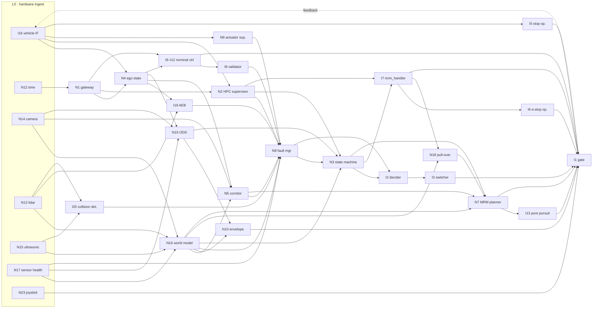

# Implementation and Demo Plan — Safety Island on NXP S32Z2

| | |
| :-- | :-- |
| Design baseline | *L4 Safety Island for Autoware — Software Design*, **Release V1.0** (version 20261023) |
| Platform | **NXP S32Z2** on the **X-S32Z27X-DC** evaluation board, **FreeRTOS + nano-ros**: the Least-Cost branch of design D10 / §9.5 |
| Status | Plan, for review. No code is written against it yet. |
| Companion | [ARCHITECTURE.md](ARCHITECTURE.md) — how S32Z2 and R-Car X5H share one code base |

Node identifiers (`I*` migrated Autoware nodes, `N*` new island nodes, `H*` new HPC nodes, `B1`–`B6`
behaviours) are those of the design. Section references (§) point into the design document.

---

## 1. What is being built

### 1.1 The S32Z2 island

| Item | Least-Cost branch on S32Z2 (§9.5) |
| :-- | :-- |
| Processor | S32Z2: 8 × Cortex-R52 (lockstep or split), Neon, DSP/ML processor, 19 MB on-chip SRAM |
| Forward camera (rank 1) | 1 × low-resolution mono, 100BASE-T1 Ethernet; encodes its own B5 video stream |
| Radar (rank 2) | **none**, so **`N6` is not built for this platform** |
| Ultrasonic (rank 3) | 5: three across the front, two on the kerb side |
| IMU / GNSS (rank 4) | 1 |
| 2D lidar (rank 5) | 1, so **`N13` is built**, and it is `I19`'s AEB input |
| Island ODD | City-road class, about 30 km/h fallback speed, fair weather |
| First vehicle | NTU golf cart (steering angle + velocity interface; `I15` not needed) |

### 1.2 Node inventory for this platform

**Migrated Autoware nodes (§4.1)**: 17 built, 1 not needed on the golf cart.

| # | Package | Tier | Partition | Status | Work package |
| :-- | :-- | :-- | :-- | :-- | :-- |
| I1 | `control_command_gate` | T0 | P0 | port | WP3 |
| I2 | `command_mode_decider` | T0 | P0 | port; **plugins replaced by a static table** | WP3 |
| I3 | `command_mode_switcher` | T0 | P0 | port; static configuration | WP3 |
| I4 | `command_mode_types` | — | lib | port (header-only) | WP0 |
| I5 | `stop_mode_operator` | T0 | P0 | port; already ported in the evaluation island | WP2 |
| I6 | `mrm_emergency_stop_operator` | T0 | P0 | port; already ported in the evaluation island | WP3 |
| I7 | `mrm_handler` | T0 | P0 | port; already ported. Availability re-sourced from `N2`; timeout re-parameterised (500 ms breaks the 70 ms budget) | WP3 |
| I8 | `control_validator` | T1 | P1 | port | WP4 |
| I9–I12 | `trajectory_follower_node`, MPC lateral, PID longitudinal, follower base | T2 | P3 | **already ported (phase 0)**; retarget to S32Z2; OSQP iteration cap + time budget on I10 | WP1 |
| I13 | `pure_pursuit` | T1 | P1 | port | WP4 |
| I14 | `shift_decider` | T2 | P3 | port (optional: `I5` auto-park covers gear P) | WP4 |
| I15 | `raw_vehicle_cmd_converter` | T2 | P3 | **not built for the golf cart**; per vehicle | — |
| I16 | vehicle interface | T0 | P0 | **new per vehicle** (golf-cart CAN FD); E2E-protected | WP2 |
| I19 | `autonomous_emergency_braking` | T1s | P2 | port; input = `N13` lidar `PointCloud2` | WP5 |
| I20 | `collision_detector` | T1s | P2 | port; input = `N13` + `N15` | WP5 |

**New island nodes (§6)**: 21 built (18 safety nodes plus `N21`–`N23` for B5/B6), `N6` not built, `N20` optional.

| # | Node | Tier | Partition | Work package |
| :-- | :-- | :-- | :-- | :-- |
| N1 | `si_safety_gateway`: E2E ingress / egress | T0 | P0 | WP2 |
| N2 | `si_hpc_supervisor`: liveness, `OperationModeAvailability`, recovery verdict | T0 | P0 | WP2 (+ recovery verdict in WP6) |
| N3 | `si_state_machine` | T0 | P0 | WP3 (states grow WP6–WP9) |
| N4 | `si_vehicle_state_estimator` | T0 | P0 | WP2 |
| N5 | `si_corridor_monitor` | T1 | P1 | WP6 |
| N7 | `si_mrm_planner` (also called `si_mrm_profile`) | T1 | P1 | WP4 (ramp) → WP6 (`v_hold`) → WP7 (pull-over path) |
| N8 | `si_fault_manager` | T0 | P0 | WP3 (sources added in every later WP) |
| N9 | `si_actuator_supervisor` | T1 | P1 | WP2 |
| N10 | `si_envelope_monitor` | T1 | P1 | WP8 |
| N11 | `si_event_recorder` | T3 | P4 | WP10 |
| N12 | `si_time_quality_monitor` | T1 | P1 | WP2 |
| N13 | `si_scan_guard`: 2D lidar | T1s | P2 | WP5 |
| N14 | `si_vision_guard`: camera; **the mandatory sensing node** | T1s | P2 | WP5 |
| N15 | `si_proximity_guard`: ultrasonic | T1s | P2 | WP5 |
| N16 | `si_safety_world_model` | T1s | P2 | WP5 |
| N17 | `si_sensor_health`: declares the blackout | T1s | P2 | WP3 (camera validity only) → WP5 (full) |
| N18 | `si_pull_over_manager` | T1 | P1 | WP7 |
| N19 | `si_odd_monitor` | T1s | P2 | WP8 |
| N20 | `si_object_digest` *(optional, §3.5)* | T1s | P2 | WP10 |
| N21 | `si_rcc_link` *(RCC comms deferred in V1.0)* | T1/T3 | P1/P4 | WP9 (interface + stub) |
| N22 | `si_teleop_streamer`: forwards the camera's own stream | T3 | P3s | WP9 (stub) |
| N23 | `si_local_control`: wired joystick | T1 | P1 | WP9 |

**HPC-side nodes (§7)** are built on the Autoware side in parallel. They are dependencies of the
island WPs, listed in §3.3.

---

## 2. Dependencies among the nodes

### 2.1 Source and method

Every edge comes from the edge catalogue in `messageflow/L4SafetyIsland-MessageFlow.md` (§3, tables
A–F, and the E / V badges), restricted to this platform: `N6` removed, `N13` kept, `I15` dropped. An
edge *u → v* means **v consumes a message u produces**. Taken literally, 24 of the island's nodes form a
single cycle. The vehicle closes the loop (`I1 → I16 → N4 → I9 → I1`), and every behaviour
reports its status back to the node that commanded it. To get a build order, the plan separates two
kinds of edge:

- **Forward edges**: a node needs this input to do its job. They set the order.
- **Feedback edges**: the actuator command path (`I1 → I16`, `I1 → N9`) and the status and
  acknowledgement replies (`N7 → N3`, `N5 → N3`, `N18 → N3`, `N18 → I7`, `I6 → I7`, `N10 → N2`,
  `N18 → N19`, `N3 → N5`, `N3 → N21`). Node tests stub them, and only integration closes them.

### 2.2 Dependency levels

A node at level *k* needs only nodes at levels below *k* (forward edges only):

| Level | Nodes | Depends on |
| :-- | :-- | :-- |
| **L0** | `I16` · `N12` · `N13` · `N14` · `N15` · `N17` · `N23` | hardware and the HPC only |
| **L1** | `I5` · `N1` · `N9` · `N16` | `I16`; `N12`; the sensing ingest |
| **L2** | `N2` · `N4` | `N1`, `I16` |
| **L3** | `I9` (+ I10–I12) · `I19` · `I20` · `N5` · `N19` · `N21` · `N22` | `N4`, `N1`, sensing |
| **L4** | `I8` · `I14` · `N10` | `I9`, `N4`, `N16`, `N19` |
| **L5** | `N8` | **11 producers**: `I8 I19 I20 N1 N2 N5 N9 N16 N17 N21 N23` |
| **L6** | `N3` | `N2 N8 N16 N19` |
| **L7** | `I2` · `I7` · `N11` | `N3`, `N8`, `I8` |
| **L8** | `I3` · `I6` · `N18` | `I2`; `I7`; `I7 N1 N4 N16` |
| **L9** | `N7` | `N1 N3 N4 N5 N16 N18` |
| **L10** | `I13` | `N1 N4 N7` |
| **L11** | `I1` | **12 command sources**: `I3 I5 I6 I7 I9 I13 I14 N1 N7 N10 N21 N23` |



### 2.3 What the dependency structure means for the plan

1. **The hubs are built interface-first.** `I1` (12 command sources) and `N8` (11 fault sources) sit
   at the bottom of the order, but every behaviour needs them. Each is built **early, with all of its
   ports declared**, and the ports are filled as producers arrive. An unconnected `I1` port is a
   source that never wins arbitration. An unconnected `N8` source is a row in the fault table with
   no producer yet. Neither blocks the other work packages.
2. **The message definitions are everyone's dependency.** Every edge is a typed topic, so
   `autoware_safety_island_msgs` (Part 3 of the design) and the E2E profiles come before any node:
   WP0.
3. **The B4 path is a closed sub-graph at the root of the order.** The nine nodes `N4 N3 N8 N17 I7 I6
   I1 I16 I5` consume no exteroceptive topic. Only `N17`'s camera-validity verdict reaches them,
   through `N8`. They are therefore built and demonstrated first (WP2–WP3). Every later WP adds
   capability *above* a floor that already works.
4. **Sensing is a parallel track.** `N13`–`N17` and `N16` sit at L0–L1 with no dependency on P0, as
   §12 of the design notes. WP5 runs alongside WP2–WP4 and joins at `N8`, `N3`, `N5` and `N7`.
5. **Behaviours are built in dependency order, not number order.** B2 needs `N5`, which needs the
   camera corridor (`N14`, `N16`). B3 needs `N18` and the B2 machinery in `N7`. B1 needs `N19`,
   which needs the sensing chain. So the order is **B4 → B2 → B3 → B1**, then B6 and B5.

### 2.4 Design gaps that block a work package

The message-flow companion (§5 there) found places where V1.0 names a message but not one of its
ends. Each must be settled before the WP that implements it. This plan does not change the design.

| Gap | Blocks | Proposed handling |
| :-- | :-- | :-- |
| Remote / external command has no §8.1 interface row | WP3 (`I1` port), WP9 | Reserve the `I1` port in WP3; define the row before WP9 |
| `N17` and `N16` both declare the sensing blackout | WP3, WP5 | Ask the WG for one owner (and the open-decision-15 debounce) before WP3 exits |
| `N7` and `I7` both command the hazard lamps | WP3, WP4 | One owner, decided before WP4 |
| No node named as the odometry arbiter (HPC vs `N4`) | WP2 | Implement in `N4`, as the companion draws it; confirm with the WG |
| Who closes the longitudinal loop during an MRM (`N7` profile vs `I11` PID) | WP4 | Decide before WP4; §9.4 recommends `I11` |
| `N7` has two names | — | Use `si_mrm_planner` (§6.3, §9.4) |

---

## 3. Work packages

Each WP lists what it builds, what it depends on, how it is tested, and the demo or exit criterion.
Tests are summarised here and detailed in §4.

### 3.1 Sequence and tracks

```
Track A — authority and control   WP0 ─ WP1 ─ WP2 ─ WP3 ─ WP4 ─┬─ WP6 (B2) ─ WP7 (B3) ─ WP8 (B1) ─ WP9 (B6/B5) ─ WP10
Track B — island sensing                 └──────── WP5 ─────────┘
Track C — HPC side (Autoware)      H1 H7 H2 H5 ──── H6 ────────── H3 ────────── H8 ────────── H4
```

### 3.2 The work packages

#### WP0: Foundations (no node depends on anything that is not here)

| | |
| :-- | :-- |
| Builds | `autoware_safety_island_msgs`: every *new* type in §8.1–§8.2 with fixed-capacity bounds (`SafetyCorridor`, `HpcCapability`, `OddStatus`, `HpcHeartbeat`, `PullOverRefuge`, `IslandState`, `SafetyWorldState`, `IslandSensorHealth`, `OddVerdict`, `FallbackAvailability`, `SafetyEnvelopeCommand`); `I4` command-mode types; **SI-E2E/A and /B as a configuration of nano-ros's built-in E2E protocol** (decision Q1: it covers both profiles, so no E2E library is written): Data ID per interface, counter width, CRC and length per profile, and the §8.1 age limits; one `*.contract.yaml` per node, taken from §8 and §9 (rates, age limits, partitions, the hazard `hpc_loss` with FTTI 70 ms); the test harness (scripted publishers, recorders, golden-trace comparison) |
| Depends on | Design V1.0 |
| Tests | Message size bounds (static); E2E: every row of the §8.4 threat table is detected (corruption, repetition, reordering, loss, delay, masquerade, wrong interface, truncation); the contract checker passes on the declared rate hierarchy and the 70 ms budget |
| Exit | Contracts check clean in CI; the E2E configuration passes the threat table |

#### WP1: Phase 0 on the X-S32Z27X-DC

FreeRTOS + nano-ros already run on this board (earlier evaluation), so there is no platform
bring-up step. WP1 only puts the island's own structure on it.

| | |
| :-- | :-- |
| Builds | Core and partition map for the island (P0/P1 on lockstep cores, P2 on its own core with `N14`'s pixel stages on the DSP or Neon, P3/P3s/P4 on split cores); nano-ros with Cyclone DDS on the HPC boundary; **`I9`–`I12` retargeted from the evaluation island to the board** |
| Depends on | WP0; the evaluated FreeRTOS + nano-ros setup on the X-S32Z27X-DC |
| Tests | `I9`–`I12` closed loop against the Autoware planning simulator; OSQP iteration cap holds `I10` inside its budget; P3 overload does not disturb P0 |
| Exit | **Phase 0 reproduced on the board**: trajectory following on the island against unmodified Autoware |

#### WP2: Base layer, L0–L2 (the inputs of the safety core)

| | |
| :-- | :-- |
| Builds | `I16` golf-cart vehicle interface (CAN FD TX/RX, SI-E2E/B); `N12` time quality; `N1` E2E gateway (ingress + egress), **a thin adapter over nano-ros's E2E** that turns every verification failure into a safety event for `N8` (§8.4, §9.3 risk 4); `N4` ego-state estimator (wheel speed, steering, ESC yaw/accel; island IMU/GNSS; cross-check against the HPC reference); `N2` HPC supervisor (heartbeat, per-topic rate, latency, island-local `OperationModeAvailability`); `N9` actuator supervisor; `I5` stop-mode operator |
| Depends on | WP1. HPC side: **H1** (E2E egress), **H7** (heartbeat), **H2** (capability vector), **H5** (trajectory conditioner) |
| Tests | `N1`: every E2E failure is a safety event, never a dropped message; age limits per §8.1; a lost time base (`N12`) invalidates age checks. `N2`: three missed 100 Hz heartbeats is detected in ≤ 30 ms. `N4`: dead-reckoning drift against a reference trajectory; switches to island-only odometry on divergence. `N9`: commanded vs achieved mismatch and response-time faults are detected. `I16`: CAN FD timing, E2E on actuator commands and feedback |
| Exit | Island sees HPC liveness and its own ego state; fault events reach a stub `N8` |

#### WP3: The safety floor: authority core and B4 (design phase 1)

| | |
| :-- | :-- |
| Builds | `N8` fault manager (static fault tree, DTC store, reaction table; **all 11 source ports declared**, first sources `N1 N2 N9`, the FSI line); `N3` state machine (all states of §6.1; guards for B2/B3/B1 stubbed false); `I2`/`I3` static table-driven; `I7` with re-sourced availability; `I6`; **`I1` with all 12 ports declared** and its built-in stop; `N17` reduced to camera validity and the blackout declaration |
| Depends on | WP2 |
| Tests | State machine: every transition of §6.1, including `EMERGENCY_STOP` from **every** state with no guard; one-way transitions cannot be reversed. Gate: source arbitration per §10.4; built-in stop on selected-source timeout. `I7` ↔ `I6` `OperateMrm` service path (**phase-1 exit criterion of §9.3**). Fault-reaction budget ≤ 70 ms, measured with target tracing |
| Demo **D1** | **HPC loss and island blindness, on the bench.** The HPC heartbeat is cut: the island takes authority and stops the vehicle model on a bounded ramp. Then the camera is unplugged: B4 emergency stop, hazard lamps at entry, auto-park at standstill. Run on S32Z2 hardware-in-the-loop with the planning simulator as the HPC |
| Exit | The nine-node B4 path works and is measured inside budget |

#### WP4: Fallback control tier (part of design phase 2)

| | |
| :-- | :-- |
| Builds | `N7` MRM planner (bounded `Trajectory` ≤ 50 points; lateral-acceleration, steering-rate and jerk bounds); `I13` pure pursuit; `I11`/`I9` as the MRM longitudinal law (§9.4 recommendation); `I8` control validator (reject ⇒ switch to fallback tier); `I14` (optional) |
| Depends on | WP3 (`N3` activation, `I1` port); WP1 (`I9`–`I12`) |
| Tests | `I13` tracks `N7`'s path within the corridor bound; the two-tier switch happens within one cycle when `I10` overruns or `I8` rejects; `N7` never emits a profile outside its hard bounds; P3 is shed before P2 under overload |
| Exit | **In-lane bounded stop** on a remembered trajectory after HPC loss |

#### WP5: Island sensing chain (design phase 3; parallel with WP2–WP4)

| | |
| :-- | :-- |
| Builds | `N14` vision guard (Ethernet camera, 640 × 400 mono, 15 Hz; classical IPM, gradient, line fitting, column scan; lane lines, road edge, drivable lateral space); `N13` scan guard (2D lidar; bounded `PointCloud2`); `N15` proximity guard (5 ultrasonics); `N17` sensor health (full: frame rate, blockage, degradation); `N16` safety world model (conservative fusion, camera-anchored corridor, explicit **no-valid-source**); `I19` AEB on `N13`; `I20` collision detector on `N13` + `N15` |
| Depends on | WP1 (partition map; sensor I/O on the board); **open decision 8** (classical CV or a certified smart camera) settled for the camera chosen |
| Tests | Recorded and synthetic camera sequences with ground-truth lanes (detection rate, lateral error, latency; ≈ 0.3 Gop/s fits the budget); lidar and ultrasonic replay; fusion rules: any source can add a hazard, only the camera can create a corridor, lower ranks may only narrow; **blackout is distinguishable from an empty road**; AEB raises an ERROR for an in-path target at 30 km/h with the 13 m stopping distance of §9.5 |
| Exit | Obstacle-aware stop: the island stops for what it sees (WP4's stop now shortens for obstacles) |

#### WP6: B2, lane hold after HPC loss

| | |
| :-- | :-- |
| Builds | `N5` corridor monitor (camera required once the island drives; `H3` refines while fresh); `N3` `LANE_KEEP_HOLD` with `T_hold`, the latched ODD class and the fork to B3 / B4; `N7` `v_hold` ramp (running minimum of five bounds, monotone non-increasing); `N2` recovery verdict and hand-back |
| Depends on | WP4, WP5. HPC side: **H3** (corridor), **H6** (island state client) |
| Tests | Descent to `v_odd` = 30 km/h inside the hold window (50→30 km/h in 2.8 s at 2 m/s²); hand-back only after the full confirmation window; `T_hold` expiry forks to B3 with camera, B4 without; corridor lost ⇒ B4 |
| Demo **D2** | **HPC fails on a city road, the island holds the lane, the HPC comes back.** Run as software-in-the-loop, then on the golf cart at ≤ 30 km/h on a closed course |

#### WP7: B3, pull over

| | |
| :-- | :-- |
| Builds | `N18` pull-over manager (`OperateMrm` server in the existing `pull_over_manager` slot; refuge go / no-go; the abort ladder; the **island-detected refuge** from `N14`, with the side ultrasonic pair able to disqualify it and the lidar confirming the edge); `N7` lateral displacement path; `I7` selects the pull-over MRM |
| Depends on | WP6. HPC side: **H8** (refuge publisher) |
| Tests | The three search outcomes are kept apart (*found* / *positively none* → in-lane stop / *inconclusive* → B4) within `T_refuge`; each abort-ladder rung removes a requirement and never adds one; pull-over to the instrumented (kerb) side only; long indicator dwell and low lateral rate in place of rear-corner radar |
| Demo **D3** | **HPC lost and does not return: the golf cart pulls over** to a nominated refuge, and to an island-detected one when `H8` offers none |

#### WP8: B1, ODD degradation, and the guardian role

| | |
| :-- | :-- |
| Builds | `N19` ODD monitor (camera contrast + **lidar-versus-camera** divergence; IMU friction; asymmetric hysteresis; the ODD-switch demand, `T_ack`, `T_odd` and the two-part acceptance test); `N10` envelope monitor and `SafetyEnvelopeCommand`; `N2` compliance supervision |
| Depends on | WP5, WP6. HPC side: **H4** (ODD reporter, declared domain) |
| Tests | Visibility loss is detected, and a fog domain declared by the HPC **fails verification** on this branch, as §9.5 requires; `T_odd` expiry picks its successor in the §3.2 order (blackout → B4, HPC lost → B2, otherwise → B3); the HPC is constrained before it is overridden |
| Demo **D4** | Camera visibility degraded (fogged lens or occluder): the island demands an ODD switch, the HPC answers, and the island verifies the answer or escalates |

#### WP9: B6 joystick and B5 tele-operation

| | |
| :-- | :-- |
| Builds | `N23` local control (wired joystick, dead-man, `v_local`, `T_local`; local source outranks remote); B5 path: `N21` command-and-liveness interface, `N22` forwarding the camera's own encoded stream, both **as stubs against a test RCC**, because V1.0 defers the RCC communication design (§8.6) |
| Depends on | WP3 (`I1` ports). The remote-command interface row (§2.4) must be defined |
| Tests | Every row of the §6.6 failure table: cable pulled, enabling switch released, link loss, video freeze, replayed or corrupted command, B6 pre-empting B5, camera lost during B5 ⇒ B4 |
| Demo **D5** | Operator drives the stopped vehicle off the road with the joystick at creep speed (B6) |

#### WP10: Audit and options

| | |
| :-- | :-- |
| Builds | `N11` event recorder (pre/post-event ring buffer, UDS/DTC export, P4); `N20` object digest *(optional)* |
| Tests | Graded-reaction step 4 (audit) met; digest is conservative-only (never removes a hazard, never validates a corridor) and goes invalid on its carry-over bounds |
| Exit | **Required before any pilot** (§9.4: the recorder is not needed for a bench demo) |

### 3.3 HPC-side dependencies

| HPC node | Needed by | Purpose on the link |
| :-- | :-- | :-- |
| H1 `si_bridge_hpc` | WP2 | E2E egress, the only HPC writer to the island; uses the same nano-ros E2E profiles, so it is also a thin adapter |
| H7 `hpc_heartbeat` | WP2 | 100 Hz heartbeat, 20 ms age |
| H2 `hpc_capability_reporter` | WP2 | Fixed-size capability vector |
| H5 `hpc_trajectory_conditioner` | WP2 | 250-point bounded trajectory |
| H6 `hpc_island_state_client` | WP6 | Island verdict back into the AD API |
| H3 `hpc_corridor_publisher` | WP6 | Map corridor for `N5` |
| H8 `hpc_refuge_publisher` | WP7 | Lawful refuge for `N18` |
| H4 `hpc_odd_reporter` | WP8 | Declared domain for the B1 exchange |
| H9 `hpc_shadow_control_monitor` | optional | Field monitoring only |

### 3.4 Minimal pull-over island

§9.4 and §12 recommend the shortest path to a demonstrable L4 fallback: phases 1, 3 and 4 reduced
to their mandatory nodes, deferring the guardian role. On S32Z2 that is **WP2 + WP3 + WP4 (`N7`,
`I13`, `I9`/`I11`/`I12`) + WP5 + WP7 (`N18`)**, which delivers D1 and D3. It is 21 mandatory nodes
with `N13` in place of `N6`, plus the 3 recommended. WP6's B2 hold and WP8's guardian role
(`I8`, `N10`) can follow.

---

## 4. Testing

### 4.1 Test levels

| Level | Where | What it proves | Used from |
| :-- | :-- | :-- | :-- |
| **T1 Unit** | Host | Node logic against its specification. Migrated nodes bring their Autoware test suites with them; new nodes get tests written from the §6 tables | WP0 |
| **T2 Node-in-the-loop** | Host build: FreeRTOS POSIX port, or nano-ros on POSIX | One node with scripted inputs and golden output traces; contract terms (rate, age, latency) checked by the contract tooling; feedback edges stubbed (§2.1) | WP2 |
| **T3 Software-in-the-loop** | Autoware planning simulator as the HPC + island as a host build, Cyclone DDS | Behaviours end-to-end, with every edge closed. The setup already used for the evaluation island | WP3 |
| **T4 Hardware-in-the-loop** | X-S32Z27X-DC + HPC PC + CAN FD vehicle simulator + sensor replay | Timing on the real target: target traces, the ≤ 70 ms reaction budget, partition isolation under overload, memory fit | WP1 |
| **T5 Vehicle** | NTU golf cart, closed course, ≤ 30 km/h, fair weather | The Least-Cost ODD as claimed | WP6 |

The S32Z2 board is in the lab, so T4 is available from WP1 onward and no emulated target is needed
on the critical path. One board is shared by every work package, so T2 and T3 on the host build carry
the day-to-day regression load, and T4 runs on merge and for timing measurements.

### 4.2 Fault-injection matrix

Taken from the design's Part 4 list (§12) and the §6.6 failure table, restricted to this branch.

| Fault | Injected at | Expected response | Verified in |
| :-- | :-- | :-- | :-- |
| HPC hang (heartbeat stops) | HPC process suspended | `N2` detects ≤ 30 ms; authority to the island; B2 (or bounded stop before WP6) | WP3, WP6 |
| HPC link flood | Traffic generator on TSN | Rate limits hold; P0 unaffected | WP2 |
| Stale trajectory | Delay injector | `N1` age reject → last valid trajectory → `N7` profile | WP2, WP4 |
| E2E corruption, replay, masquerade | Frame mutator | Safety event to `N8`; never a silent drop | WP0, WP2 |
| Actuator non-response | CAN FD simulator | `N9` → B4; during B4 → gate built-in stop + FSI line | WP3 |
| Camera lost | Unplug / blank frames | `N17` blackout → B4 from **any** state | WP3, WP5 |
| All island sensors blind at once | Every sensor stream cut | B4, unchanged; the nine-node path consumes no exteroceptive topic | WP5 |
| Lidar lost | Unplug | AEB disarmed and recorded; camera behaviours continue | WP5 |
| Ultrasonic lost | Unplug | No tight-to-kerb end; stop within the shoulder | WP7 |
| FSI `SOC_ERROR` | GPIO driven | Highest-priority fault, ≤ 1 ms detection | WP3 |
| Power loss of the HPC | Supply cut | As HPC hang | WP6 |
| Overload of the island | CPU hog in P3 / P3s | P3 shed first; P0–P2 keep their periods | WP4 |
| Visibility loss | Fogged lens / occluder | `N19` demand; fog domain fails verification | WP8 |
| Joystick cable pulled, enabling switch released | Hardware | Immediate stop, `I6` then `I5` | WP9 |
| RCC link loss mid-B5 | Test RCC | In-lane stop, or B4 without the camera | WP9 |

### 4.3 Evidence carried forward to the safety case

- The contract checker's verdicts in CI (rates, budgets, ladders that terminate), per commit.
- Timing traces from the target for every reaction path in the table above.
- nano-ros's own verification evidence for its E2E protocol (Kani / Verus), inherited for SI-E2E/A and /B (Q1).
- nano-ros's allocation-site report (`rmw-alloc-sites.py`) for the T0 partition (§9.3).
- Structural coverage and static-analysis results for P0 and P1 code, to the level the ASIL
  allocation in Part 4 requires.

---

## 5. Decisions

### 5.1 Taken

| # | Decision | Consequence for the plan |
| :-- | :-- | :-- |
| Q1 | **nano-ros's built-in E2E protocol satisfies SI-E2E/A and /B** (§8.4, §9.3 risk 4) | WP0 configures the profiles instead of writing an E2E library; `N1` and `H1` are thin adapters; the island inherits the middleware's own verification evidence for the protocol |
| Q2 | **Rust on the safety island**: the new island nodes are written in Rust on nano-ros | New `N*` nodes are `no_std` Rust (R4 and D5's memory-safety requirement met at the language level); node logic is shared Rust crates, per [ARCHITECTURE.md](ARCHITECTURE.md) |

### 5.2 Still open

| # | Question | Needed by |
| :-- | :-- | :-- |
| Q3 | Intra-island transport for P0 (open decision 7) | WP1 |
| Q4 | Camera: classical CV or certified smart camera (open decision 8) | WP5 |
| Q5 | Blackout owner and debounce (§2.4 above; open decision 15) | WP3 |
| Q6 | The remaining §2.4 gaps: hazard-lamp owner, MRM longitudinal owner, odometry arbiter | WP2–WP4 |
| Q7 | Sensor placement on the golf cart (open decision 21(c)) | WP5 |
